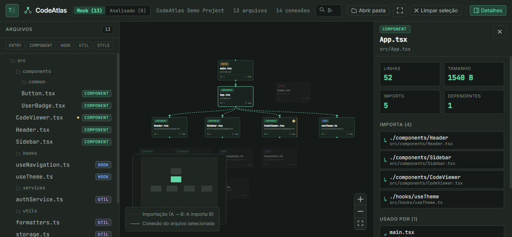
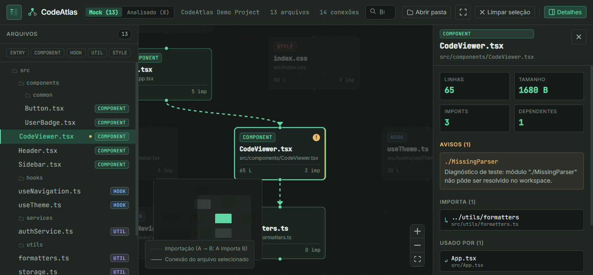
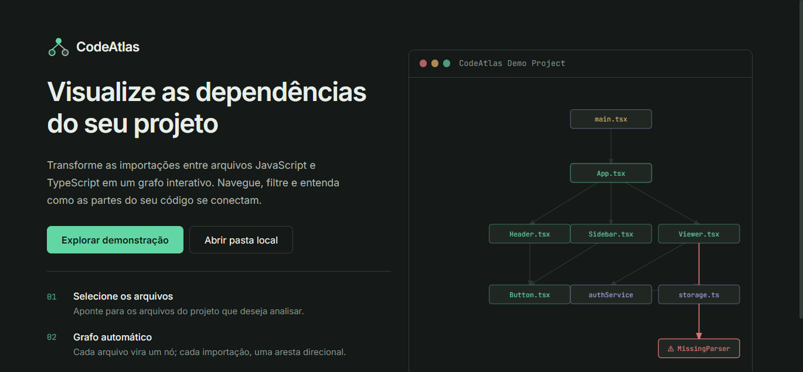
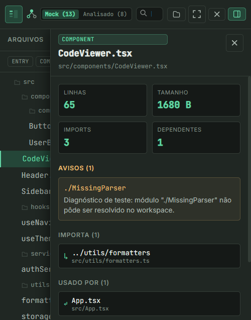

# CodeAtlas

> **Visualizador interativo de dependências e arquitetura para projetos JavaScript e TypeScript.**

🔗 **Acesse a aplicação online:** [https://thiagoibrahimvieira.github.io/CodeAtlas/](https://thiagoibrahimvieira.github.io/CodeAtlas/)  
📄 **Apresentação para Portfólio:** [docs/PORTFOLIO.md](docs/PORTFOLIO.md)

---

## 📸 Demonstração Visual

### Workspace Principal — Grafo de Dependências e Métricas


### Painel de Detalhes, Relações e Diagnósticos de Importações


### Tela Inicial (Landing Page) e Versão Mobile
| Tela Inicial (Landing Page) | Responsividade Mobile (Gavetas & Backdrop) |
| :---: | :---: |
|  |  |

---

## 📌 Sobre o Projeto e Problema Resolvido

Em projetos de software com dezenas ou centenas de módulos (Next.js, Vite, React, monorepos), torna-se complexo rastrear o impacto de alterar ou remover um arquivo central. Identificar acoplamentos indesejados, dependências em cascata, módulos circulares e importações fantasmas ou quebradas consome tempo de engenharia e aumenta o risco de regressões.

O **CodeAtlas** resolve esse problema transformando grafos de importação abstratos em uma experiência visual direta, interativa e determinística:
- **Mapeamento em tempo real:** cada arquivo transforma-se em um nó semântico; cada importação, em uma aresta direcionada ($A \to B$: $A$ importa $B$).
- **Processamento 100% Client-Side:** todo o parsing de código, extração de AST e resolução de módulos ocorre **localmente na memória do navegador**. Nenhum arquivo de código-fonte é enviado para servidores externos ou serviços de telemetria, garantindo total privacidade e segurança.

---

## 🚀 Funcionalidades

### 1. Grafo Interativo com React Flow (@xyflow/react)
- **Nós Semânticos:** categorizados e estilizados por tipo de arquivo (`entry`, `component`, `hook`, `util`, `style`).
- **Arestas Direcionadas:** setas direcionais indicando o sentido exato da dependência.
- **Foco Contextual Bidirecional:** ao selecionar um arquivo, suas dependências diretas e todos os arquivos que dependem dele são realçados, atenuando os nós não relacionados.
- **Controles de Navegação:** zoom suave, pan, centralização (*fit view*) e minimapa interativo com guia de legendas.

### 2. Analisador Estático JS/TS no Navegador
- **Parsing Formal de AST:** utiliza a **TypeScript Compiler API** (`ts.createSourceFile`) para analisar declarações de importação estática (`import ... from '...'`), re-exports (`export ... from '...'`), imports dinâmicos (`import(...)`) e `require()`.
- **Resolução de Caminhos e Extensões:** resolve caminhos relativos (`./`, `../`), arquivos index (`index.ts`, `index.tsx`, `index.js`, `index.jsx`) e arquivos `.json`.
- **Suporte a Aliases (`tsconfig.json` / `jsconfig.json`):** resolve mapeamentos de caminhos configurados em `compilerOptions.paths` (como `@/*` ou `~/*`), inclusive com prefixos customizados e wildcards.
- **Diagnósticos em Tempo Real:** identifica módulos não resolvidos, módulos externos de pacotes npm e dependências geradas ou ignoradas propositalmente.

### 3. Carregamento de Projetos Locais
- **Seleção de Pastas no Computador:** suporte à seleção direta de diretórios locais via navegador (`webkitdirectory`).
- **Filtro Inteligente de Diretórios:** ignora automaticamente diretórios desnecessários (`node_modules`, `.git`, `.next`, `dist`, `build`, etc.) para manter o processamento leve e instantâneo.
- **Memória Virtual Isolada:** leitura assíncrona dos arquivos para a memória e execução completa do pipeline de análise em milissegundos.

### 4. Árvore de Arquivos e Busca em Tempo Real
- **Navegação Hierárquica:** estrutura de diretórios em árvore com contadores de arquivos por pasta.
- **Filtros Rápidos por Tipo:** chips interativos para filtrar visualmente por componentes, hooks, utils ou estilos.
- **Busca em Tempo Real:** filtragem instantânea por nome ou caminho de arquivo, com realce de correspondências e alerta de avisos.

### 5. Painel de Detalhes e Métricas
- **Métricas do Arquivo:** contagem de linhas de código, tamanho em bytes, quantidade de importações e número de arquivos dependentes.
- **Blocos de Avisos Diagnósticos:** detalhamento de imports não encontrados no workspace.
- **Navegação Rápida:** botões clicáveis para navegar imediatamente entre arquivos que importam ou são importados pelo nó ativo.
- **Pacotes Externos e Exportações:** listagem de bibliotecas terceiras utilizadas e identificadores exportados.

### 6. Acessibilidade e Responsividade
- **Conformidade WCAG 2.2 AA:** taxa de contraste de texto calculada e validada (`--text-muted: #829288` com razão de 5.33:1 contra o fundo escuro).
- **Semântica HTML e ARIA:** estrutura com `<h1>`, `<h2>`, `<h3>`, contêiner `role="tree"` com nós `role="treeitem"`, `aria-selected` e `aria-label` descritivos.
- **Acessibilidade por Teclado:** indicador de foco visível padronizado (`:focus-visible`) e respeito automático a `prefers-reduced-motion`.
- **Design Totalmente Responsivo:** layout otimizado para desktop amplo (1440px), notebooks (1024px), tablets (768px) e smartphones (375px) com gavetas móveis retráteis e backdrop interativo.

---

## 🏗️ Arquitetura e Fluxo de Análise

O CodeAtlas é estruturado em três camadas independentes e desacopladas:

```text
┌────────────────────────────────────────────────────────┐
│                   Entrada de Dados                     │
│  (Pasta Local via webkitdirectory / Modos Demonstrativos) │
└───────────────────────────┬────────────────────────────┘
                            │
                            ▼
┌────────────────────────────────────────────────────────┐
│             Camada de Análise Estática                 │
│  1. localProjectLoader: extrai arquivos e tsconfig      │
│  2. parseImports: gera AST via TypeScript Compiler API │
│  3. resolveDependencies: resolve caminhos e aliases     │
│  4. buildGraph: calcula layout de nós e arestas       │
└───────────────────────────┬────────────────────────────┘
                            │
                            ▼
┌────────────────────────────────────────────────────────┐
│                 Interface e Grafo                      │
│  • React 19 State (currentProject, selectedId)         │
│  • FileTree: navegação em árvore e filtros de tipo     │
│  • DependencyGraph: renderização via @xyflow/react     │
│  • NodeDetails: métricas, conexões e diagnósticos      │
└────────────────────────────────────────────────────────┘
```

### Otimização de Performance com Code-Splitting
A TypeScript Compiler API é uma dependência robusta. Para garantir que a **Landing Page inicial carregue instantaneamente**, o CodeAtlas utiliza **Dynamic Import** (`import('./mock/analyzedProject')` e `import('./analyzer/buildGraph')`). A biblioteca do compilador só é baixada pelo navegador quando o usuário inicia a análise de um projeto.

---

## 🔒 Privacidade e Segurança

- **100% Processamento Local:** ao carregar um projeto local, os arquivos são lidos diretamente para a memória JavaScript do navegador (`FileReader` / `File API`).
- **Nenhum Envio para Servidores:** a aplicação não possui backend, banco de dados ou endpoints de upload. Nenhum trecho de código trafega pela rede.
- **Auditoria de Dependências:** verificação contínua via `npm audit` com **0 vulnerabilidades**.

---

## 🛠️ Tecnologias Utilizadas

- **[React 19](https://react.dev/):** construção de interfaces reativas com hooks e arquitetura baseada em componentes.
- **[TypeScript 6](https://www.typescriptlang.org/):** tipagem estática rigorosa para garantir contratos de dados consistentes.
- **[TypeScript Compiler API](https://github.com/microsoft/TypeScript):** análise léxica e sintática (AST) para extração fiel de declarações de dependência.
- **[Vite 8](https://vite.dev/):** ambiente de desenvolvimento ultrarrápido e empacotador de produção otimizado com Rollup.
- **[@xyflow/react](https://reactflow.dev/):** biblioteca para renderização interativa de grafos de nós e arestas no canvas.
- **Vanilla CSS (Design Tokens):** sistema de design autoral com variáveis CSS nativas, paleta Grafite (`#151917`, `#202723`) e Verde Menta (`#63D6A5`).
- **[Vitest](https://vitest.dev/):** framework de testes unitários e de integração de alta velocidade.
- **[Oxlint](https://oxc.rs/):** linter de alta performance em Rust para garantia de qualidade estática de código.
- **[GitHub Actions](https://github.com/features/actions):** pipeline automatizado de CI/CD para validação e publicação contínua no GitHub Pages.

---

## 📂 Estrutura de Pastas do Repositório

```text
CodeAtlas/
├── .github/
│   └── workflows/
│       └── deploy.yml      # Pipeline CI/CD para GitHub Pages
├── docs/
│   ├── assets/             # Capturas de tela e ilustrações da aplicação
│   └── PORTFOLIO.md        # Documento executivo para apresentação em portfólio
├── public/                 # Favicon e ícones estáticos
├── src/
│   ├── analyzer/           # Motor de análise estática de código
│   │   ├── buildGraph.ts   # Construtor do grafo determinístico de nós e arestas
│   │   ├── parseImports.ts # Extração de imports e exports via TypeScript AST
│   │   └── resolveDependencies.ts # Resolução de caminhos relativos, aliases e JSON
│   ├── components/         # Componentes de interface do usuário
│   │   ├── details/        # Painel lateral de métricas e diagnósticos
│   │   ├── fileTree/       # Árvore de arquivos, filtros e busca
│   │   ├── graph/          # Grafo interativo React Flow e nós customizados
│   │   ├── layout/         # Barra superior (HeaderBar) e controles
│   │   └── LandingPage.tsx # Tela inicial com apresentação técnica
│   ├── mock/               # Dados simulados e projeto analisado de demonstração
│   ├── services/           # Carregador de projetos locais (File API client-side)
│   ├── types/              # Definições de tipos TypeScript (AtlasProject, etc.)
│   ├── App.tsx             # Ponto de entrada do workspace e orquestração de estado
│   ├── App.css             # Estilização semântica e regras de responsividade
│   └── index.css           # Tokens de design globais, foco visível e acessibilidade
├── package.json            # Dependências e scripts do projeto
├── tsconfig.json           # Configurações do compilador TypeScript
├── vercel.json             # Configuração alternativa de deploy para Vercel
└── vite.config.ts          # Configuração do Vite com base path dinâmico
```

---

## 💻 Como Executar Localmente

### Pré-requisitos
- **Node.js** (versão 18 ou superior)
- **npm** (incluso com o Node.js)

### Passo a Passo

1. **Clone o repositório:**
   ```bash
   git clone https://github.com/ThiagoIbrahimVieira/CodeAtlas.git
   cd CodeAtlas
   ```

2. **Instale as dependências:**
   ```bash
   npm install
   ```

3. **Inicie o servidor de desenvolvimento:**
   ```bash
   npm run dev
   ```
   Acesse `http://localhost:5173` no navegador.

### Scripts Disponíveis

| Comando | Descrição |
|---|---|
| `npm run dev` | Inicia o servidor local de desenvolvimento com Hot Module Replacement (HMR) |
| `npm test` | Executa a suíte completa de testes automatizados com Vitest |
| `npm run lint` | Executa o linter Oxlint para validação estática de boas práticas |
| `npm run build` | Compila o TypeScript e gera o bundle de produção otimizado em `dist/` |
| `npm run preview` | Executa um servidor local simulando a versão compilada de produção |

---

## 📖 Como Analisar um Projeto Local

1. Abra o CodeAtlas (online ou localmente).
2. Na barra superior (ou na tela inicial), clique em **"Abrir pasta"** (ou *"Abrir pasta local"*).
3. Selecione o diretório raiz de qualquer projeto JavaScript ou TypeScript.
4. O navegador solicitará confirmação para ler os arquivos da pasta selecionada.
5. Em poucos instantes, o CodeAtlas analisará as importações, lerá o `tsconfig.json`/`jsconfig.json` e renderizará o grafo completo na tela.

> **Dicas e Requisitos:**
> - Recomenda-se selecionar projetos baseados em JavaScript ou TypeScript com extensões `.ts`, `.tsx`, `.js`, `.jsx` ou `.json`.
> - Se o projeto utilizar aliases de caminho (como `@/components`), certifique-se de que o arquivo `tsconfig.json` ou `jsconfig.json` esteja na raiz da pasta selecionada.

---

## ⚠️ Limitações Conhecidas

- **Linguagens Suportadas:** O analisador atual é especializado no ecossistema JavaScript e TypeScript. Linguagens como Python, Go, Rust, Java ou C# não são analisadas nesta versão.
- **Monorepos Complexos:** Em monorepos com múltiplos pacotes internos sem aliases explícitos no `tsconfig.json` raiz, algumas dependências entre pacotes podem ser classificadas como pacotes externos do npm.
- **Grafos Densos no Mobile:** Embora toda a interface seja responsiva com gavetas adaptativas, a visualização de grafos com mais de 100 nós é mais confortável em monitores desktop ou notebooks devido ao espaço de tela.

---

## 🗺️ Roadmap e Evolução do Projeto

- [x] **Fase 1: Interface Inicial e Grafo Interativo** (React Flow, nós semânticos, design tokens)
- [x] **Fase 2: Analisador Estático JS/TS** (TypeScript Compiler API, extração de AST, ordenação determinística)
- [x] **Fase 3: Leitura de Projetos Locais** (File API, processamento in-memory no navegador)
- [x] **Fase 4: Resolução de Aliases e JSON** (Suporte a `tsconfig.json`, `jsconfig.json`, módulos `.json`)
- [x] **Fase 7: Auditoria Técnica, Testes e Qualidade** (54 testes automatizados, Oxlint, code-splitting)
- [x] **Fase 8: Polimento, Responsividade e Acessibilidade** (Conformidade WCAG 2.2 AA, gavetas móveis)
- [x] **Fase 9: Publicação da Versão Web** (CI/CD GitHub Actions, deploy contínuo no GitHub Pages)
- [x] **Fase 10: Portfólio, Apresentação e Documentação** (Screenshots reais, documentação profissional, guia executivo)

### Horizontes Futuros (Pós-Roadmap Original)
- [ ] Detecção automatizada de dependências circulares (ciclos arquiteturais).
- [ ] Identificação de arquivos órfãos (código morto não importado por nenhum nó).
- [ ] Métricas avançadas de acoplamento aferente ($Ca$) e eferente ($Ce$).
- [ ] Suporte a importação direta via URL de repositório público do GitHub.

---

## 📄 Licença

Este projeto é disponibilizado sob a licença [MIT](LICENSE), desenvolvido para fins de aprendizado, portfólio de engenharia de software e pesquisa em ferramentas de produtividade para desenvolvedores.
